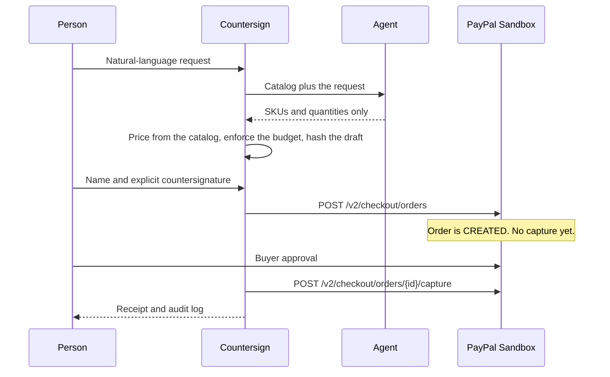
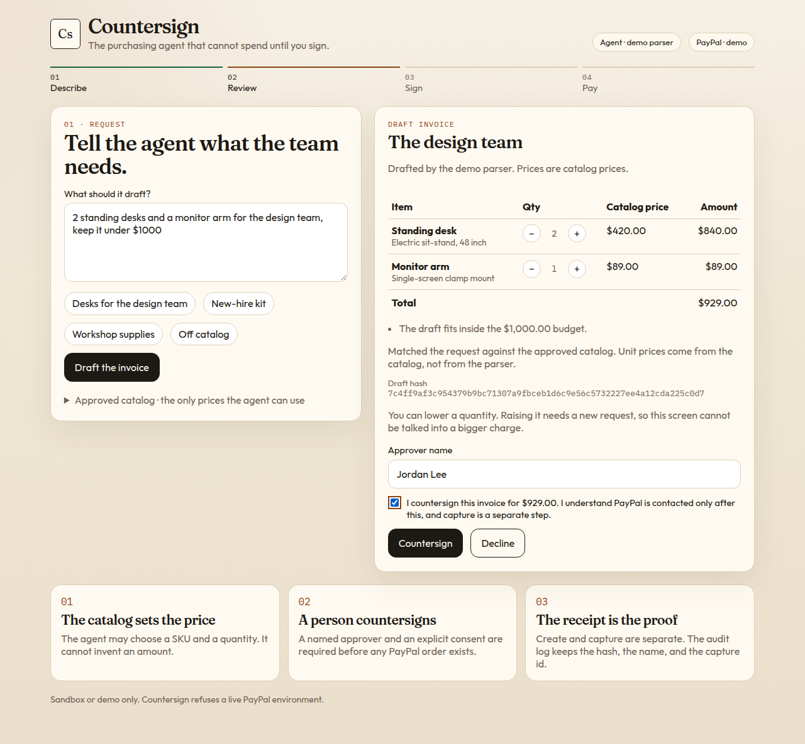
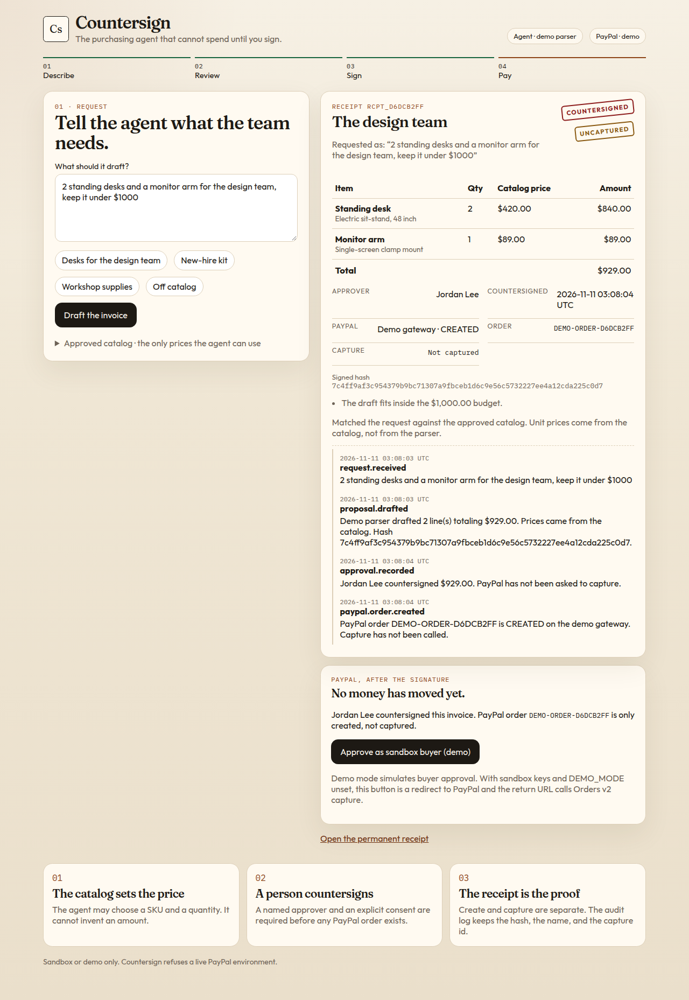
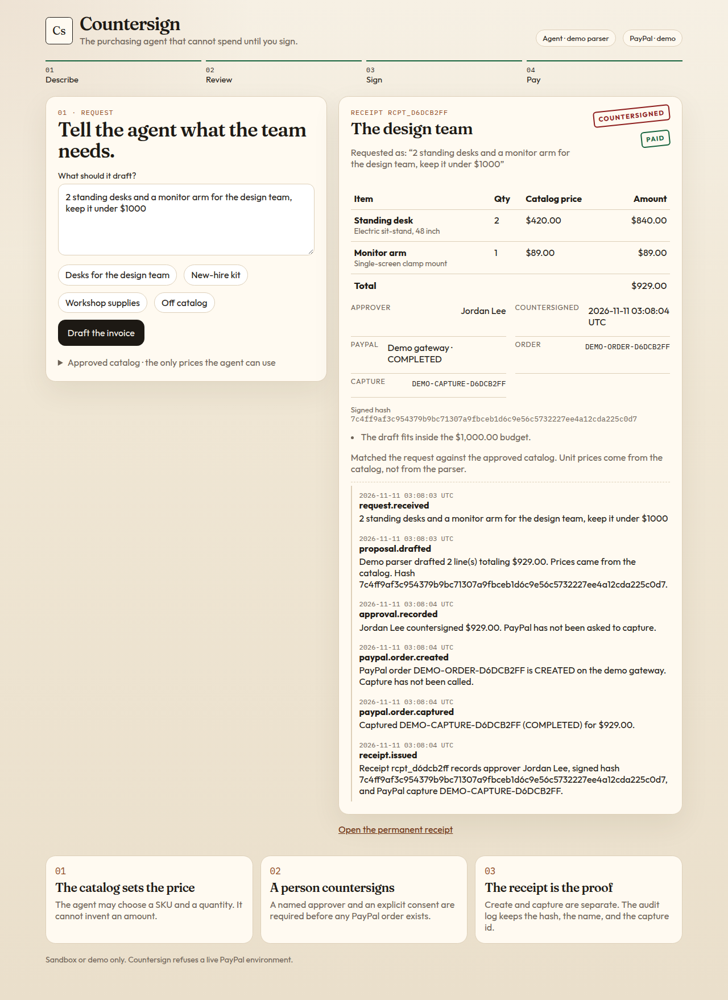

# Countersign

Countersign is a purchasing agent for a small team. A person describes what they need. The agent drafts an invoice from an approved catalog. A named human countersigns it. Only then does the app create a PayPal order, and only after buyer approval does it capture the payment and write a receipt.

The agent proposes. A person approves. The receipt proves it.

This project was built for the [PayPal AI Hackathon](https://paypalaihackathon.devpost.com/). It uses the PayPal Sandbox Orders v2 API together with an AI draft step. It does not call the live PayPal API.

## What you can do

1. Describe a purchase in plain English.
2. Review a draft whose unit prices come from the catalog, not from the model.
3. Lower a quantity if you want. You cannot raise it on this screen.
4. Countersign with your name and an explicit consent checkbox, or decline.
5. See a PayPal order that has been created and not captured.
6. Approve as the buyer. In demo mode that step is simulated. In sandbox mode it is the PayPal approval page, and the return URL captures the order.
7. Open a receipt with the approver, the signed hash, the order id, the capture id, and an audit log.

An off-catalog request, such as "Buy me a yacht", produces nothing to sign and no PayPal call.

## Architecture



The language model is optional. With no `LLM_API_KEY`, a deterministic demo parser matches the same catalog. Either way, the server prices the lines. A model response cannot set a unit price, add an unknown SKU, or skip the countersignature.

PayPal is called only from the server, with the Orders v2 Sandbox API:

- `POST /v1/oauth2/token`
- `POST /v2/checkout/orders`
- `POST /v2/checkout/orders/{id}/capture`

The return URL lives in `payment_source.paypal.experience_context`. Amounts are integer cents until they are formatted for PayPal. `PAYPAL_ENV=live` is rejected.

## Demo mode and sandbox mode

| Keys | `DEMO_MODE` | What runs |
| --- | --- | --- |
| Absent | unset or `true` | Demo parser and a simulated PayPal gateway |
| Present | `true` | Still the demo path, so a recording cannot spend sandbox money by accident |
| PayPal keys present, no LLM key | `false` or unset | Real Sandbox orders, demo parser |
| PayPal keys and `LLM_API_KEY` | `false` or unset | Real Sandbox orders and the language model |

The badges at the top of the page tell you which path is live. Demo mode is a real pass through the same approval gate. It does not skip ahead to a fake receipt.

## Setup

Requirements: Node.js 22.

```bash
npm install
cp .env.example .env.local
npm run dev
```

Open [http://localhost:3000](http://localhost:3000).

The checked-in example sets `DEMO_MODE=true`, so the app runs with no secrets. Leave the key fields empty.

### Environment variables

| Variable | Required | Purpose |
| --- | --- | --- |
| `DEMO_MODE` | No | `true` forces the demo agent and the demo PayPal gateway even if keys are set. |
| `PAYPAL_CLIENT_ID` | Sandbox only | Sandbox REST app client id. |
| `PAYPAL_CLIENT_SECRET` | Sandbox only | Sandbox REST app secret. Never commit it. |
| `PAYPAL_ENV` | No | Must be `sandbox`. Any other value stops the app. |
| `APP_BASE_URL` | Sandbox only | Origin PayPal redirects back to. Default `http://localhost:3000`. |
| `LLM_API_KEY` | No | Bearer token for an OpenAI-compatible chat completions API. |
| `LLM_BASE_URL` | No | Default `https://api.openai.com/v1`. |
| `LLM_MODEL` | No | Default `gpt-4o-mini`. |

Copy `.env.example` to `.env.local`. Do not put real keys in `.env.example` or in git.

### PayPal Sandbox credentials

1. Open [https://developer.paypal.com/](https://developer.paypal.com/) and sign in, or create a free developer account.
2. Go to **Apps & Credentials**.
3. Switch the toggle to **Sandbox**, not Live.
4. Create an app, for example "Countersign".
5. Copy the **Client ID** and **Secret** into `PAYPAL_CLIENT_ID` and `PAYPAL_CLIENT_SECRET`.
6. Open **Sandbox accounts** (under Testing). The app's business account receives the payment. Use the **personal** sandbox account as the buyer when the approval window opens. PayPal shows the email and a viewable password on that page.
7. In `.env.local`, set `DEMO_MODE=false` and `PAYPAL_ENV=sandbox`.
8. Restart `npm run dev`. The PayPal badge should say **sandbox**.

If the badge still says demo, `DEMO_MODE` is still true or one of the PayPal variables is empty. Restart after every env change. Next.js reads `.env.local` on startup.

The sandbox approval window asks you to log in as the personal sandbox buyer. After you approve, PayPal returns to `/paypal/return`, and Countersign captures the order. If you cancel, the receipt stays uncaptured and records that. If capture is attempted before approval, PayPal returns `ORDER_NOT_APPROVED` and the receipt stays open so you can try the approval link again.

### Language model

Leave `LLM_API_KEY` empty to use the demo parser. To use a model, set an OpenAI-compatible endpoint and set `DEMO_MODE=false`:

```bash
DEMO_MODE=false
LLM_API_KEY=sk-...
LLM_BASE_URL=https://api.openai.com/v1
LLM_MODEL=gpt-4o-mini
```

The model receives the catalog and must return JSON with SKUs and quantities. Unknown SKUs are dropped. The server applies the budget and the catalog price after the model responds. If the provider rejects JSON mode, the app retries once without `response_format`.

## Scripts

```bash
npm run dev     # http://localhost:3000
npm test        # unit tests for pricing, the approval gate, and the Sandbox client
npm run smoke   # demo-mode propose, countersign, and capture
npm run build   # production build
npm start       # serve the production build
```

Receipts are stored in `data/store.json`, which is gitignored.

## Tests and what was exercised

`npm test` and `npm run smoke` do not need network access or secrets. They cover:

- Catalog matching, budgets, and the refusal of an off-catalog request
- A model payload that tries to set its own price and invent a SKU
- The rule that capture cannot run before a countersignature, and that a declined draft never creates an order
- Quantity changes: a person may lower a line, not raise it
- The Orders v2 body: item total equals the amount, return URL is on `experience_context`, and the client talks only to `https://api-m.sandbox.paypal.com`
- A 401 from PayPal does not include the secret in the error shown to the user
- `ORDER_NOT_APPROVED` stays retryable
- `DEMO_MODE=true` forces demo even if keys are present, and `PAYPAL_ENV=live` throws

The Orders v2 client was not called against PayPal's network in this environment, because no sandbox credentials were available. The request builder, response parser, and error handling were tested with a fake `fetch`. After you add sandbox keys, the same countersign button performs the live sandbox create, redirect, and capture.

## Screenshots

These were taken in demo mode, with no API keys.







The rest of the pass, including the empty state, the off-catalog refusal, the receipt page, and a phone-width layout, is in [docs/screenshots](docs/screenshots).

## Demo video

Judges need a public YouTube video under three minutes. A shot-by-shot script timed for about 2 minutes 40 seconds is in [docs/DEMO_SCRIPT.md](docs/DEMO_SCRIPT.md). Devpost submission text is in [docs/DEVPOST.md](docs/DEVPOST.md).

Record the screen. Do not show `.env.local`, the client secret, or a sandbox password. Do not add copyrighted music or third-party logos.

## Project layout

```text
app/                  Next.js UI and API routes
components/           Invoice, receipt, and PayPal step
lib/agent.ts          Demo parser and OpenAI-compatible drafter
lib/flow.ts           Countersign, decline, capture, audit log
lib/paypal.ts         Orders v2 Sandbox client and demo gateway
docs/DEVPOST.md       Submission text
docs/DEMO_SCRIPT.md   Video script
tests/                Vitest
scripts/smoke.ts      End-to-end demo-mode smoke
```

## Safety

- No card numbers are collected.
- The browser never sees the PayPal secret or the LLM key.
- Prices are recomputed on the server from the catalog.
- A countersignature requires `confirm: true` and a name. The capture route checks that a countersignature was stored.
- This build refuses a live PayPal environment.

## License

MIT. See [LICENSE](LICENSE).
